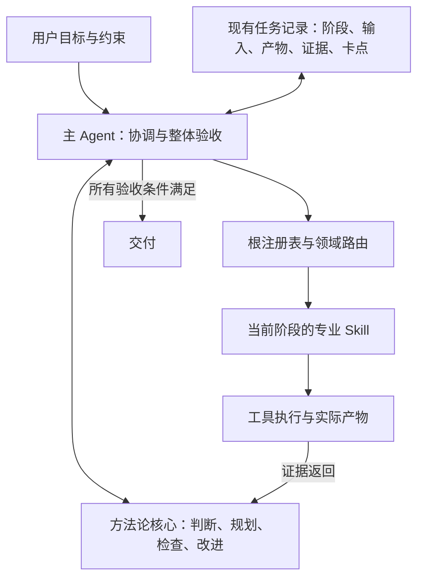
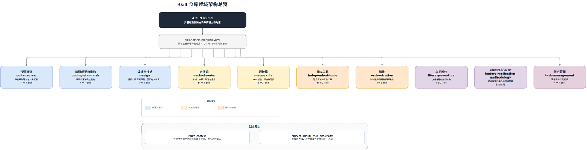
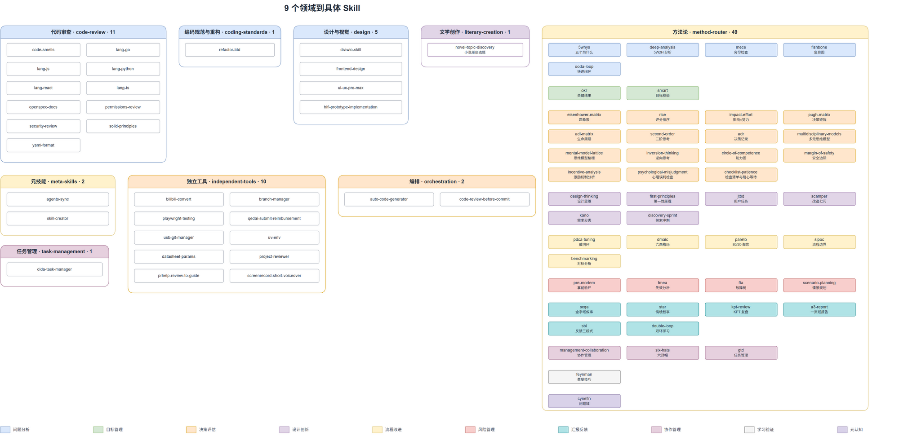

# Skills Repository

本仓库维护可复用的 Agent Skill、领域路由和跨客户端同步能力。仓库采用
`AGENTS.md -> skill-domain-mapping.yaml -> 领域 Skill -> 具体 Skill` 的分层结构。

## AGENTS.md 的职责

根目录 `AGENTS.md` 保存通用约束与整体运行约定，包括任务协调、方法论与执行能力的分工、阶段交接、Git 安全、输出语言和平台约定。
它会由 `agents-sync` 同步到 Codex、Claude Code、OpenCode、ZCode 和 Pi，因此不承载本仓库专属的领域清单、
目录说明或维护手册。

本仓库专属说明由本 README 维护；领域、Skill 名称、描述和物理路径的唯一注册源是
`skill-domain-mapping.yaml`。

## 路由结构

| 领域 | 目录 | 职责 |
|------|------|------|
| 代码审查 | `code-review/` | 按语言和风险路由审查规则 |
| 编码规范与重构 | `coding-standards/` | 通用编码约束和安全重构 |
| 设计与视觉 | `design/` | UI/UX、前端视觉、高保真源稿和图示设计 |
| 文学创作 | `literary-creation/` | 小说、网文、短篇故事与微短剧的选题和创作路由 |
| 方法论 | `method-router/` | 分析、决策、改进和报告方法 |
| 元技能 | `meta-skills/` | Skill 创建、评估和同步 |
| 独立工具 | `independent-tools/` | 边界清晰的专业工具 |
| 任务管理 | `task-management/` | 以滴答清单为行动面板的任务路由 |
| 编排 | `orchestration/` | 软件实施、开发验证与 Git 交付编排 |
| 功能复刻方法论 | `feature-replication-methodology/` | 跨仓库功能复刻流程与踩坑防线 |

根注册表负责领域、规范 `skill_name`、描述和仓库相对路径。领域映射只负责将领域内意图映射到
规范 `skill_name`，不重复保存物理路径。父 Skill 读取领域映射后，再通过根注册表解析实际路径。

当前根注册表包含 10 个领域、83 个注册 Skill；其中 `method-router` 注册 49 个方法论 Skill，按 10 个功能块组织。
`method-router/references/method-mapping.yaml` 是意图路由的权威配置，负责分类、上下文和路由链，
不应以 README 或父 Skill 中的静态清单替代。

芒格决策检查由 8 个独立叶子 Skill 组成：`multidisciplinary-models`（多元思维模型）、
`mental-model-lattice`（思维模型格栅）、`inversion-thinking`（逆向思考）、
`circle-of-competence`（能力圈）、`margin-of-safety`（安全边际）、
`incentive-analysis`（激励机制分析）、`psychological-misjudgment`（心理误判检查）、
`checklist-patience`（检查清单与耐心等待）。完整分析由 `sub_type=munger_full` 路由组合执行，
不是第九个综合 Skill；每个叶子都可以独立执行并有自己的边界与精简 eval。

### 方法论路由契约

方法论路由使用 `route_context` 描述候选上下文，字段包括 `type`、`urgency`、`domain`、
`has_data`、`complexity`、`sub_type`、`scope` 和 `cynefin_pre`。匹配策略为
`highest_priority_then_specificity`：先选优先级最高的候选，再以条件具体度（匹配条件数量）
打破同优先级冲突；仍无法唯一确定时询问用户，未命中则执行该类型的 fallback（当前为展示
Top 3 并等待选择），不猜测默认 Skill。

完全初始或几乎没有上下文的任务由 Discovery Sprint 处理：先联网调研公开实践和反例，明确
“事实 / 推断 / 假设”，再进行结构化头脑风暴，最终收敛为探索简报和首个可验证实验。探索结束
后按已明确的问题类型重新路由，不自动获得实施授权。

文学创作域中的 Novel Topic Discovery 负责小说、短篇爽文、短视频故事或微短剧选题：先形成足量不同故事
发动机，再进行同名、核心机制、人物关系和终局反转四层风险扫描，最后只交付候选与最小验证实验；
选题完成不自动授权创建项目或写正文。

根注册表只登记本仓库内的 Skill。包含 `:` 的限定名称（例如 `visualize:visualize`）属于平台或
插件提供的外部 Skill，由客户端的平台 Skill 注册表解析；领域映射必须显式标记
`resolution: platform_skill_registry`，不得为外部 Skill 伪造本仓物理路径。

## 目录约定

```text
AGENTS.md                       通用且可同步的 Agent 约束
README.md                       本仓库说明
skill-domain-mapping.yaml       全仓领域与 Skill 注册表
skill-domain-architecture.drawio 可编辑的领域总览
<domain>/SKILL.md               领域入口和路由算法
<domain>/references/*mapping.yaml 领域内意图映射
<domain>/<skill>/SKILL.md       具体 Skill
```

## 新增或移动 Skill

1. 将 Skill 放入职责匹配的领域目录，确保 `SKILL.md` 包含 `name` 和 `description`。
2. 更新 `skill-domain-mapping.yaml` 中的规范名称、描述和仓库相对路径。
3. 只有领域意图发生变化时，才更新该领域的意图映射；领域映射只引用 `skill_name`。
4. 运行仓库路由契约测试并使用 `agents-sync` 同步六套客户端的 Skill 与注册表入口。
5. 不修改 `AGENTS.md`，除非通用 Agent 约束本身发生变化。

## 跨客户端同步

`meta-skills/agents-sync` 为 Codex、Claude Code、OpenCode、ZCode、Pi 和 WorkBuddy 创建一级领域 Junction。具体 Skill
通过父域目录树发现，不创建顶层叶子别名。同步器同时把 `skill-domain-mapping.yaml` 以文件链接
暴露到六个消费者的 skills 根目录，使父域可解析仓库内 Skill 路径。同步流程不会删除普通目录；
发生冲突时先停止并要求人工处理。

## 提交前检查

本仓库是权威 Skill 源，提交前过以下固定项，避免注册表与客户端漂移：

1. **注册表一致** — 新增、移动、删除 Skill 时同步更新根注册表与所属域映射；计数以根注册表为准
2. **计数同步** — `README.md` 与 `skill-domain-architecture.drawio` 中的域数/总数/各域子 Skill 数，以及 `tests/test_method_router_contract.py` 的计数断言，三者必须与根注册表实际条目一致
3. **测试通过** — 运行下文「验证」一节的测试套件
4. **客户端同步** — 运行 `meta-skills/agents-sync`，确认六客户端 Skill 与注册表入口指向权威源；AGENTS.md 仅同步五个已核实的指令入口，WorkBuddy 全局指令入口未核实
5. **链接完整性** — 编辑 AGENTS.md 或 `skill-domain-mapping.yaml` 后确认硬链接组未被编辑工具打断（逐一验证权威源与实际受管目标的文件身份，不以固定链接数量代替），断开则重建
6. **格式回归** — YAML/JSON 保留文件末尾换行，行尾风格与原文一致

## 方法论驱动的运行架构

当前主 Agent 是执行主体；方法论指导判断、规划、检查和改进，领域能力负责具体产物。运行约定的单一来源是 `AGENTS.md` 的“方法论驱动的整体运行”；`method-router` 负责方法选择、保持与重选，各父域交接专业工作，各叶子维护输入、输出、完成条件和异常返回。



任务推进方法与当前阶段执行能力可以互补共存；简单任务直接执行，不以加载数量衡量智能程度。输入变化与恢复按依赖更新证据，已通过的无关工作不重做。方法选择不产生额外实施授权，也不取代项目已有生命周期。这里是同一 Agent 的逻辑职责，不是新增常驻管理进程。

## 任务协调与评估边界

当前主 Agent 保留目标和验收，按阶段选择主 Skill；代码任务复用既有编排与任务系统，非代码任务直接交接产物。“继续”恢复当前任务，“换素材”仅使相关产物和证据失效。

体系级验收覆盖自然任务的路由、跨阶段执行、证据回传、需求变化、依赖阻断与恢复，以及简单任务的适度执行。可复用用例见 `meta-skills/skill-creator/evals/system-evals.json`；预置 Skill/精确命令的指导性测试与自然路由测试分开报告。

评估工作区放在仓库根 `.skill-evals/<skill-name>-workspace/`，不得放入客户端发布的父域目录。历史 deep-analysis 与 pdca-tuning 快照迁至此处，历史转录中的原路径作为当时运行证据保留。新增临时运行不提交；需要长期保留的测试用例放入对应 Skill 的 evals，不能含可被发现的快照入口。

## 架构图

可编辑源文件：`skill-domain-architecture.drawio`





预览图由 draw.io CLI 从源文件导出：

```powershell
& "D:\Program Files\draw.io\draw.io.exe" -x -f png --width 2000 --page-index 1 -o skill-domain-architecture.png skill-domain-architecture.drawio
& "D:\Program Files\draw.io\draw.io.exe" -x -f png --width 2000 --page-index 2 -o skill-domain-architecture-skills.png skill-domain-architecture.drawio
```

## 验证

```powershell
python -m unittest tests.test_skill_repository_layout tests.test_additional_skill_domains
python -m unittest tests.test_method_router_contract
python -m unittest discover -s design\tests -p "test_*.py"
python -m unittest discover -s orchestration\auto-code-generator\tests -p "test_auto_code_generator.py"
python -m unittest discover -s independent-tools\screenrecord-short-voiceover\tests -p "test_*.py"
```
