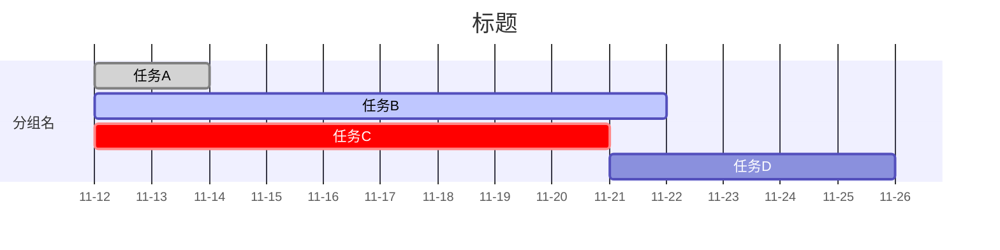

# 甘特图（termaid 终端渲染）

## 定位

把已有任务数据（滴答清单、Git issue、OpenSpec 路线图）转成 Mermaid `gantt` 源码，用
`termaid` 渲染为终端字符图。解决「任务很多但看不出时间关系和完成分布」的问题，不新建任务账本、
不改任务状态。

## 前置

- Python ≥ 3.9（实测 3.14 可用）
- `pip install termaid`（实测 v0.13.0；核心零依赖，`rich`/`textual` 仅在 `--rich`/`--tui` 时需要）

## 用法

```sh
# 写好的 Mermaid 源码存为 .mmd，再渲染
python -m termaid --ascii --width 100 tasks.mmd

# 就地渲染 Markdown 里的 mermaid 代码块
python -m termaid --markdown --ascii doc.md

# 输出到文件后再读（长图避免管道截断）
python -m termaid --ascii --width 120 tasks.mmd -o out.txt
```

常用参数：`--ascii`（纯 ASCII，兼容终端）、`--width N`（画布宽度）、`--theme`（配色，非 ASCII
模式用）、`--max-height ROWS`（限制行数）、`--demo gantt`（看官方示例）。

## Mermaid gantt 写法



- `section` 即任务分组；同一 section 内多行自动并列。
- 时长可写绝对日期 `2026-11-12, 2026-11-14`，也可写 `3d`/`2w`/`1M`，或用 `after a1` 接续依赖。
- `dateFormat` 必须与任务日期格式一致；`axisFormat` 控制底部刻度显示。

## 状态与字符（`--ascii` 实测）

| Mermaid 标记 | 终端字符 | 语义 |
|---|---|---|
| `done` | `....` | 已完成 |
| `active` | `====` | 进行中 |
| `crit` | `!!!!` | 关键路径/阻塞 |
| 无标记 | `####` | 普通排期 |

中文标签实测对齐正常（termaid 处理宽字符），无需额外处理。

## 使用流程

1. **取数**：明确数据来源与截止日（滴答清单任务、Git issue 的 created/updated/closed、OpenSpec
   roadmap 的期次）。日期必须来自真实记录，不编造计划日期。
2. **分组**：按业务线或期次划分 `section`，同组内按开始时间排序。
3. **映射状态**：已完成→`done`；正在推进或等待合入→`active`；阻塞/超期→`crit`；未开工→无标记。
   只写真实状态，推断项在回复文字里单独说明。
4. **渲染**：`python -m termaid --ascii --width 100 <file>.mmd`，把输出原样贴给用户。
5. **补充**：图后接一段文字解释读图结论（堆积点、关键路径、可立即推进项）——字符图本身不表意。

## 陷阱

1. **`termaid` 命令通常不在 PATH**：pip 会把 `termaid.exe` 装到
   `%APPDATA%\Python\Python3xx\Scripts`。一律用 `python -m termaid` 调用。
2. **长图先落文件**：行数多时直接管道容易截断，用 `-o` 写文件再读。
3. **避免一次塞太多行**：超过约 20 行后可读性骤降，按分组拆图或加 `--max-height`。
4. **不编造日期**：缺开始/结束日期时宁可只画已有区间，或在图外说明「未排期」。
5. **依赖关系**：Mermaid 的 `after` 只表达顺序，不自动推导工期；工期需显式给出。

## 边界

- 只做呈现，不修改任务系统数据（滴答清单写入仍走 `dida-task-manager`）。
- 方法论层的时间管理建议（优先级、精力匹配）不属于本 Skill，归 `method-router`。
- 需要可交互、可分享的正式交付图（SVG/PNG/链接）时改用 `design` 域的 `drawio-skill` 或外部
  MCP 甘特服务，本 Skill 只负责终端文本图。
